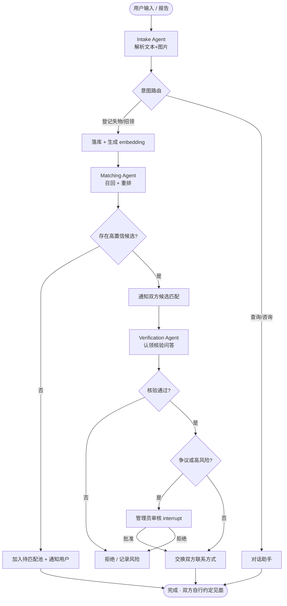

# 失物招领平台 — 产品设计需求文档（PDR）

| 项目 | 内容 |
|---|---|
| 文档版本 | v0.1（草案） |
| 日期 | 2026-10-15 |
| 状态 | 待评审 |
| 产品代号 | Find |
| 适用范围 | **校园场景**（单校区 / 多校区内部） |
| 技术栈 | Python（后端 + Agent）、Next.js（前端） |
| Agent 框架 | LangGraph（主）/ CrewAI（可选概念验证） |
| 模型服务 | DeepSeek API（`deepseek-flash` 多模态+文本；`deepseek-v4-pro` 重推理） |

---

## 1. 背景与目标

### 1.1 背景

传统失物招领平台依赖**关键词检索**：失主用「黑色钱包」搜索，而拾获者写的是「棕色短夹」、「皮夹子」，二者永远匹配不上。信息不对称导致大量物品无人认领，最终被集中销毁或长期积压。

本平台的核心价值主张是：**用 AI Agent 把"描述"理解成"语义"，把"被动搜索"升级为"主动匹配 + 自动核验 + 流程自动化"**。

### 1.2 产品目标

1. 通过语义/多模态匹配，显著提升失物与招领的匹配成功率。
2. 通过对话式助手降低用户登记与查询门槛。
3. 通过多智能体协作 + 核验，安全、可追溯地完成认领并促成双方联系。
4. 通过核验 Agent 抑制冒领欺诈（不依赖实名认证）。

### 1.3 非目标（本期不做）

- 不做跨平台/跨机构（机场、地铁、商场各自系统）的联邦检索。**仅面向校园。**
- **不做实名认证**；认领资格由核验问答 + 风险评分判定。
- **不做线下交接执行**：匹配成功后由双方**自行约定**见面，平台不设集中交接点、不承担物流。
- 不做原生移动 App（本期为响应式 Web）。
- 不做实时视频监控/智能柜硬件对接。
- 不对接学校/园区既有系统。

---

## 2. 目标用户与画像

| 角色 | 画像 | 核心诉求 |
|---|---|---|
| 失主（Owner） | 学生/教职工，刚丢失物品，焦虑、描述模糊 | 快速登记、尽快收到匹配通知、便捷认领 |
| 拾获者（Finder） | 学生/教职工，拾到物品，希望归还但怕麻烦 | 极简登记（拍照即可）、免担责、有正向反馈 |
| 管理员/运营（Admin） | 校园失物招领运营人员/志愿者 | 处理争议与高风险认领、防欺诈、数据看板 |

> 说明：因采用**双方自行约定交接**且**不强制实名**，本平台不再设「线下交接点人员」角色。

---

## 3. 核心用户场景与用户故事

### 场景 A：失主登记并自动匹配（P0）
> 作为失主，我希望拍张照片、用大白话描述物品，系统就能自动帮我找到可能的招领信息。

- 用户上传照片 + 文字描述（可含时间、地点）。
- Intake Agent 解析出结构化字段；Matching Agent 立即召回并重排出候选匹配。
- 命中则推送「疑似匹配」；未命中则进入待匹配池，后续新招领入库时反向匹配。

### 场景 B：拾获者快速登记（P0）
> 作为拾获者，我只想 30 秒登记完，不想填一堆表单。

- 拍照 + 一句话描述即可；系统自动补全类别、颜色、时间、地点。
- 登记后自行保管物品，等待匹配通知；平台不要求上交到集中点。

### 场景 C：认领核验（P0）
> 作为平台，我要确认认领者是真失主，而不是冒领者。

- Verification Agent 基于物品的**非公开细节**生成动态问题（如"钱包夹层里有什么"、"挂饰在左还是右"）。
- 认领者作答，Agent 判定置信度；低置信或高风险转人工。

### 场景 D：对话式查询（P1）
> 作为用户，我想直接问"我上周在图书馆丢的蓝色水杯有消息吗？"

- 对话助手（复用主图）理解意图、查询、返回进度，支持流式回复。

### 场景 E：管理员处理争议 / 高风险认领（P1）
> 作为管理员，我要在存在争议或高风险时介入把关。

- 一般认领：核验通过后自动进入「交换联系方式」环节，双方自行约定见面，**无需人工**。
- 争议/高风险（低置信核验、多人认领同一物品、被举报）时 `interrupt` 转人工。
- 管理员查看证据链（描述、图片、问答记录、匹配理由）后批准/拒绝，全程留痕。

---

## 4. 功能需求

优先级：**P0** = MVP 必须；**P1** = 重要；**P2** = 增强。

### 4.1 用户与账户

| ID | 需求 | 优先级 |
|---|---|---|
| FR-1.1 | 注册/登录（校园邮箱或手机号 + 验证码） | P0 |
| FR-1.2 | 角色区分：失主 / 拾获者 / 管理员 | P0 |
| FR-1.3 | **联系方式验证**（手机/邮箱，用于匹配后互相联系）；**不做实名核验** | P0 |
| FR-1.4 | 用户信任分（历史核验、被拒记录）——无实名下的主要风控依据 | P1 |

### 4.2 物品登记

| ID | 需求 | 优先级 |
|---|---|---|
| FR-2.1 | 提交失物报告 / 招领登记（文字 + 图片） | P0 |
| FR-2.2 | 多图上传（≤ 6 张），自动生成图片描述 | P0 |
| FR-2.3 | Agent 自动抽取结构化字段并允许用户校正 | P0 |
| FR-2.4 | 校园地点选择（预置地点：图书馆/教学楼/食堂/宿舍/体育场等 + 自由备注） | P1 |
| FR-2.5 | 草稿保存与编辑 | P2 |

### 4.3 智能匹配

| ID | 需求 | 优先级 |
|---|---|---|
| FR-3.1 | 新登记后实时召回候选（Top-K）并重排打分 | P0 |
| FR-3.2 | 展示匹配度 + 可解释理由 | P0 |
| FR-3.3 | 反向匹配（新招领入库时回扫待匹配失物池） | P0 |
| FR-3.4 | 匹配阈值与人工干预调整 | P1 |
| FR-3.5 | 匹配结果去重与冷却（避免重复打扰） | P1 |

### 4.4 认领与核验

| ID | 需求 | 优先级 |
|---|---|---|
| FR-4.1 | 对匹配结果发起认领申请 | P0 |
| FR-4.2 | 动态核验问答（基于非公开细节） | P0 |
| FR-4.3 | 核验置信度评分 + 风险标记 | P0 |
| FR-4.4 | 低置信/高风险自动转人工复核（争议处理） | P0 |
| FR-4.5 | 认领证据链留存（描述/图片/问答/匹配理由），**认领成功后 1 周内随个人信息一并清理** | P0 |

### 4.5 对话助手

| ID | 需求 | 优先级 |
|---|---|---|
| FR-5.1 | 流式对话（SSE） | P1 |
| FR-5.2 | 意图识别：登记/查询进度/咨询规则 | P1 |
| FR-5.3 | 对话中直接创建报告或认领 | P1 |
| FR-5.4 | 多轮澄清（追问缺失字段） | P1 |

### 4.6 通知与联系

| ID | 需求 | 优先级 |
|---|---|---|
| FR-6.1 | 匹配命中通知（站内 + 邮件/短信） | P0 |
| FR-6.2 | 认领状态变更通知 | P0 |
| FR-6.3 | 认领确认后**交换双方联系方式**（经双方授权同意），供自行约定见面 | P0 |
| FR-6.4 | 长期未匹配/超时未认领物品提醒 | P2 |

### 4.7 管理与运营

| ID | 需求 | 优先级 |
|---|---|---|
| FR-7.1 | 争议/高风险认领审核工作台（含证据链） | P1 |
| FR-7.2 | 物品台账、状态管理、批量操作 | P0 |
| FR-7.3 | 反欺诈看板（异常认领、风险用户） | P1 |
| FR-7.4 | 数据看板（匹配率、认领率、平均时长） | P1 |
| FR-7.5 | 审计日志（谁在何时做了什么；脱敏保留） | P0 |
| FR-7.6 | **数据留存自动清理**：认领成功后 1 周内移除物品、图片及个人信息 | P0 |

---

## 5. Agent 设计（核心）

### 5.1 Agent 总览

采用 **LangGraph** 构建一张有状态图，包含 4 个子智能体 + 1 个对话入口，通过 **Supervisor/Coordinator 模式**协作。共享 State，Postgres Checkpointer 持久化，关键节点 `interrupt()` 支持人工介入。

```
                    ┌──────────────────────────────────────┐
   用户输入 ───────▶│              Coordinator              │
   (文本+图片)      │        (路由 / 通知 / HITL)            │
                    └───┬────────┬─────────┬────────┬──────┘
                        │        │         │        │
                   ┌────▼──┐ ┌───▼────┐ ┌──▼─────┐ ┌▼────────┐
                   │Intake │ │Matching│ │Verify  │ │Chat     │
                   │解析   │ │匹配    │ │核验    │ │对话助手 │
                   └───┬───┘ └───┬────┘ └──┬─────┘ └─────────┘
                       │         │         │
                   结构化字段  召回+重排  问答+评分
```

### 5.2 Intake Agent（登记解析）

- **输入**：用户文字 + 图片（≤6）。
- **能力**：多模态理解，抽取结构化字段：`category / brand / color / material / event_time / location / distinguishing_features`。
- **输出**：标准化 `Item` 记录 + 图片描述（caption）。
- **技术**：DeepSeek `deepseek-flash`（支持图片输入）+ 结构化输出（JSON mode / Pydantic schema）。
- **兜底**：字段缺失时追问；低置信字段标记待用户确认。

### 5.3 Matching Agent（匹配，核心）

**两段式，而非单次 LLM 调用：**

1. **召回（Recall）**：由 **BGE-M3** 对文本 embedding + 图像 caption embedding 编码后，在 pgvector 中检索 Top-K（如 K=20）候选。位置/时间做过滤或加权。
2. **重排（Rerank）**：对每对候选（失物 × 招领）用 `deepseek-flash` 作 LLM-judge 打分，输出 `score ∈ [0,1]` + 自然语言理由（feature overlap、时空邻近、外观一致）；争议/低置信案例升级 `deepseek-v4-pro` 复核。
3. **决策**：`score ≥ 高阈值` → 推送候选匹配；`中阈值` → 进待观察池；`低阈值` → 忽略。

- **反向匹配**：新招领入库时，用同一管线回扫 `LOST` 待匹配池。
- **可解释性**：每条匹配必须附带理由，供用户与管理员判断（也是防错关键）。

### 5.4 Verification Agent（核验 / 反欺诈）

- 基于物品的**非公开细节**动态生成问题（仅真正的失主能答）。
- 记录问答，输出核验置信度；对自相矛盾/常识错误/高风险用户加分惩罚。
- 低置信或高风险 → 转人工，不自动放行。

### 5.5 Coordinator Agent（协调）

- 路由意图（登记 / 查询 / 认领 / 咨询）。
- 编排子智能体调用顺序。
- 触发通知、促成双方联系方式交换。
- **HITL**：仅在争议/高风险认领时 `interrupt()`，等待管理员审核；一般认领无需人工。

### 5.6 对话助手（Chat）

- 复用同一张图，入口走 Coordinator 的 `chat` 分支。
- SSE 流式返回；支持登记、查询进度、问规则。
- 多轮澄清缺失信息。

### 5.7 LangGraph 状态图（流程）



**State 核心字段**：`user_id, intent, item_draft, item_id, candidates[], selected_match, claim, verification{}, status, messages[], audit[]`。

### 5.8 工具清单（Tools）

| 工具 | 说明 |
|---|---|
| `parse_item(images, text)` | 解析结构化字段 |
| `embed_item(item)` | 生成向量并入库 |
| `search_candidates(item, k)` | 向量召回 |
| `score_match(lost, found)` | 重排打分 + 理由 |
| `create_report(item)` | 落库 |
| `create_claim(match_id, user_id)` | 创建认领 |
| `generate_verification_questions(item)` | 生成核验问题 |
| `notify_user(user_id, template, payload)` | 通知 |
| `exchange_contacts(claim_id)` | 认领确认后交换双方联系方式 |
| `escalate_to_human(thread_id)` | 争议/高风险 HITL 升级 |

### 5.9 人类介入（HITL）

- 仅两类情况人工介入：**争议/高风险认领**、**低置信核验**。一般认领核验通过后自动交换联系方式，无需人工。
- 用 LangGraph `interrupt()` + checkpointer，流程可暂停数小时/数天后从断点恢复。

### 5.10 安全与防滥用

- 核验问题**不得泄露**物品非公开细节给未认领者。
- 用户侧仅看到公开字段 + 匹配理由，敏感字段服务端隔离。
- 限流 + 认领尝试次数限制 + 风险用户封禁。

---

## 6. 匹配引擎设计

| 环节 | 方案 |
|---|---|
| 文本向量 | **BGE-M3 自建向量化服务**（对文本 + 图片 caption 统一编码） |
| 图像理解 | DeepSeek `deepseek-flash` 生成 caption → 再由 BGE-M3 向量化 |
| 向量库 | Postgres + pgvector（起步）；量大迁 Qdrant/Milvus |
| 召回策略 | 向量 Top-K + 时空过滤/加权 |
| 重排 | DeepSeek `deepseek-flash` LLM-judge（JSON 打分 + 理由）；可选 BGE-reranker-v2-m3 快筛 |
| 打分维度 | 外观一致、类别一致、时空邻近、细节吻合、图片相似 |
| 阈值 | 可配置；初期保守（宁缺勿滥），用评测集校准 |

**评测闭环**：构建标注数据集（人工判定的正/负匹配对），量化 precision/recall，用 Langfuse 持续追踪线上匹配质量。

---

## 7. 非功能需求

| 维度 | 要求 |
|---|---|
| 性能 | 登记解析 P95 < 8s；实时匹配 P95 < 5s；对话首 token < 2s |
| 可用性 | 核心登记/匹配 99.5%；Agent 失败可降级为「进入待匹配池」 |
| 可扩展 | Agent 与匹配服务无状态可水平扩展；队列削峰 |
| 安全 | 鉴权、越权防护、敏感字段隔离、传输/存储加密 |
| 隐私合规 | 遵守个人信息保护相关法规；图片与联系方式最小化留存；**认领成功后 1 周内移除物品及个人信息，审计日志脱敏保留** |
| 范围 | 面向校园，单校区规模；地点使用预置校园地点标签，无需城市级地图 |
| 可观测 | 全链路 trace（Langfuse/LangSmith）、审计日志、指标看板 |
| 幂等 | 登记、认领、通知接口幂等，避免重复提交/重复打扰 |

---

## 8. 系统架构

```
┌─────────────────────────────────────────────┐
│  前端 Next.js  (Web + 对话 UI + 物品列表)       │
└───────────────┬─────────────────────────────┘
                │  REST / SSE(对话) / WebSocket
┌───────────────▼─────────────────────────────┐
│  后端 FastAPI  (认证、上传、业务 API、鉴权)      │
└───────┬───────────────────────┬─────────────┘
        │                       │
┌───────▼──────────┐   ┌────────▼─────────────┐
│  Agent 层         │   │  匹配服务              │
│  LangGraph        │──▶│  BGE-M3 向量化 + 召回   │
│  Intake/Match/    │   │  + DeepSeek 重排       │
│  Verify/Chat      │   └────────┬─────────────┘
│  (DeepSeek API)   │            │
└───────┬───────────┘   ┌────────▼─────────────┐
        │               │ Postgres + pgvector  │
        │               │ S3/MinIO(图片) Redis  │
        └──────────────▶│ 队列 Celery/ARQ       │
                        └─────────────────────┘
```

**组件职责**
- **前端**：登记、匹配展示、对话、认领、管理员工作台。
- **后端 API**：业务与权限边界；调用 Agent/匹配服务。
- **Agent 层**：LangGraph 图 + Checkpointer（存 Postgres）。
- **匹配服务**：独立可复用，供 Agent 以工具形式调用（也可被后台反向匹配任务调用）。内含 **BGE-M3 向量化服务** + **DeepSeek LLM-judge 重排**。
- **数据层**：Postgres（业务 + 向量 + 图状态）、MinIO（图片）、Redis（缓存 + 队列）。

---

## 9. 数据模型（核心表）

| 表 | 关键字段 |
|---|---|
| `users` | id, role, name, email, phone, password_hash, trust_score, contact_verified, created_at |
| `items` | id, type(LOST/FOUND), reporter_id, category, title, description, brand, color, material, event_time, location_tag, status, embedding(vector), retention_delete_at, created_at |
| `item_images` | id, item_id, url, caption, embedding(vector) |
| `matches` | id, lost_item_id, found_item_id, score, reason, status(pending/confirmed/rejected), created_at |
| `claims` | id, match_id, claimant_id, status, risk_level, created_at |
| `verification_qa` | id, claim_id, question, answer, judgement, confidence |
| `contact_exchanges` | id, claim_id, lost_contact, found_contact, consent_lost, consent_found, exchanged_at |
| `notifications` | id, user_id, channel, template, payload, status, created_at |
| `audit_logs` | id, actor_id, action, target_type, target_id, detail(jsonb), created_at（脱敏保留） |
| `purge_jobs` | id, item_id, scheduled_at, executed_at（认领成功后 1 周内执行清理） |
| `checkpoints/*` | LangGraph Checkpointer 自动建表（thread 状态持久化） |

索引：`items.embedding`（ivfflat/hnsw）、`items.type+status`、`matches(lost_item_id, found_item_id)` 唯一约束。

---

## 10. 技术栈选型

| 层 | 选型 | 说明 |
|---|---|---|
| Agent 编排 | **LangGraph** | 有状态、可控、多智能体、HITL |
| LLM 接入 | **DeepSeek API**（OpenAI/Anthropic 兼容）+ LiteLLM | Base URL `https://api.deepseek.com`，可直接用 OpenAI SDK |
| 后端 | FastAPI + Pydantic | 异步、类型安全、自动文档 |
| 任务队列 | Celery 或 ARQ + Redis | 反向匹配、通知异步化 |
| 数据库 | Postgres + pgvector | 事务 + 向量一体 |
| 对象存储 | MinIO（自建）/ S3 | 图片 |
| 前端 | Next.js + Vercel AI SDK / assistant-ui | 对话流式 + Web |
| 可观测/评测 | Langfuse（自建）或 LangSmith | 匹配质量量化 |
| 模型（多模态+文本） | DeepSeek `deepseek-flash` | 图片理解、对话、常规重排 |
| 模型（重推理） | DeepSeek `deepseek-v4-pro` | 最终匹配裁定、核验判定 |
| Embedding | **BGE-M3 自建向量化服务** | DeepSeek 无 embedding；自建保数据不出域 |
| 重排 | DeepSeek `deepseek-flash` LLM-judge | 保持单一厂商；后续可加 BGE-reranker 快筛 |

---

### 10.1 DeepSeek API 集成要点（已定）

**接入方式**：DeepSeek API 兼容 OpenAI / Anthropic 格式。Base URL `https://api.deepseek.com`（Anthropic 格式加 `/anthropic`）。可直接用 OpenAI SDK / LiteLLM / LangChain `ChatOpenAI`（自定义 `base_url`）接入 LangGraph，无需额外适配层。

**模型分工**：

| 模型 ID | 能力 | 承担角色 |
|---|---|---|
| `deepseek-flash`（V4.1-Flash） | 图片输入 + 文本 + 工具调用 + JSON 输出，1M 上下文，价格低 | Intake 图片解析、对话助手、常规重排 |
| `deepseek-v4-pro`（V4-Pro-0813） | 文本推理更强，**不支持视觉** | 最终匹配裁定、核验判定、疑难对话 |

**要点**：
- **思考模式**：默认开启 thinking（`reasoning_effort` 可调档）。核验/匹配等需严谨判断处保留，简单解析关闭以省成本、降延迟。
- **图片输入**：支持 base64 内联、外链 URL、Files API（`file_id`）三种；格式 JPEG/PNG/GIF/WebP；单请求 ≤600 张；每图折算 ≤1024 token。登记图片建议走 Files API 复用、避免重复上传。
- **成本**：按 token 计费，缓存命中极低；**非高峰时段半价**（高峰为 UTC 周一至周五 01:00–04:00、06:00–10:00）。
- **旧别名**：`deepseek-chat` / `deepseek-reasoner` 已于 2026-07-24 退役，勿再使用。

> ⚠️ **关键缺口：DeepSeek API 不提供 Embedding，也无专用 Rerank 接口。** 语义召回必须另配向量化方案。

**Embedding 方案（已定）：自建 BGE-M3。**

- 部署为独立向量化服务（`sentence-transformers` + FastAPI，或 TEI/text-embeddings-inference），对**文本 + 图片 caption** 统一编码后写入 pgvector。
- 起步 CPU 跑小批量即可，量上来再加 GPU；中文语义优于通用 API。
- 优点：免费、数据不出域、与 DeepSeek 云端解耦。

**重排（已定）：DeepSeek `deepseek-flash` 作 LLM-judge**，JSON 输出打分 + 理由（争议/低置信升级 `deepseek-v4-pro`）。若后续延迟或成本不满足，再评估叠加 BGE-reranker-v2-m3 作为前置快筛。

**合规提示**：用户上传的失物照片与描述会发送至 DeepSeek 云端，需评估数据留存与个人信息合规（见 §7、§15）。

---

## 11. API 概览（示例）

| 方法 | 路径 | 说明 |
|---|---|---|
| POST | `/api/items` | 提交失物/招领（文字+图片） |
| GET | `/api/items/{id}/matches` | 获取候选匹配 |
| POST | `/api/claims` | 发起认领 |
| POST | `/api/claims/{id}/verify` | 提交核验回答 |
| POST | `/api/chat` | 对话（SSE 流式） |
| GET | `/api/admin/claims` | 争议/高风险待审核列表 |
| POST | `/api/admin/claims/{id}/approve` | 审核放行（恢复 interrupt） |
| POST | `/api/claims/{id}/exchange-contacts` | 认领确认后交换双方联系方式 |

---

## 12. 里程碑与路线图

| 阶段 | 目标 | 交付 |
|---|---|---|
| M1（1-2 周） | 匹配能力验证 | FastAPI + pgvector，跑通「登记 → 召回+重排 → 展示候选」，构建评测集 |
| M2（2-3 周） | Agent 化 | LangGraph 引入 Intake / Matching / Coordinator 子图 + Checkpointer |
| M3（2 周） | 对话助手 | SSE 对话 + 登记/查询/认领意图 |
| M4（1-2 周） | 安全闭环 | Verification 核验 + 联系方式交换 + 争议 HITL + 通知 |
| M5（1-2 周） | 运营与打磨 | 管理后台 + 数据留存清理任务 + 看板 + Langfuse 评测 |

---

## 13. 成功指标（KPI）

| 指标 | 目标（初版） |
|---|---|
| 匹配召回率（Recall@K） | ≥ 80% |
| 匹配精确率（人工判定） | ≥ 70% |
| 匹配后认领成功率 | ≥ 40% |
| 冒领拦截率 | ≥ 95%（核验 + 风险评分 + 争议复核） |
| 平均匹配时长（登记→通知） | < 5 分钟 |
| 登记完成率 | ≥ 70% |
| 用户满意度（认领者） | ≥ 4.2/5 |

---

## 14. 风险与对策

| 风险 | 影响 | 对策 |
|---|---|---|
| 匹配误报打扰用户 | 体验差、信任流失 | 保守阈值 + 去重冷却 + 可解释理由 |
| 冒领欺诈（无实名） | 物品错发、法律风险 | 动态核验问答 + 风险评分 + 信任分 + 争议人工复核 |
| 双方自行见面的安全 | 人身/财产安全 | 建议校园公共区域见面 + 安全提示 + 举报通道 |
| 多模态/LLM 成本高 | 成本失控 | 缓存、小模型前置、按需调用、批量异步 |
| Agent 幻觉/不稳定 | 流程错误 | 结构化输出 + 校验 + 降级路径 + 评测 |
| 数据合规风险 | 法律风险 | 最小化采集、可删除、加密、审计 |
| 冷启动无匹配 | 价值感低 | 反向匹配 + 待匹配池 + 多渠道接入 |

---

## 15. 待决策事项（Open Questions）

| # | 决策项 | 结论 |
|---|---|---|
| 1 | 模型部署方式 | ✅ **DeepSeek API**（`deepseek-flash` 多模态+文本 / `deepseek-v4-pro` 重推理） |
| 1a | Embedding 方案 | ✅ **自建 BGE-M3 向量化服务**（见 §10.1） |
| 1b | 重排 | ✅ **DeepSeek `deepseek-flash` LLM-judge** |
| 2 | 是否强制实名核验 | ✅ **不强制实名**；以联系方式验证 + 核验问答 + 信任分替代 |
| 3 | 交接模式 | ✅ **双方自行约定**；平台不设交接点，仅促成联系方式交换 |
| 4 | 覆盖范围 | ✅ **校园**（单校区 / 校内部署） |
| 5 | 数据留存与删除 | ✅ **认领成功后 1 周内移除**物品及个人信息，审计日志脱敏保留 |
| 6 | 既有系统对接 | ✅ **不对接** |

**已无阻塞性待决策项。** 唯一遗留为上线前需完成的**数据发往 DeepSeek 云端的合规评估**（见 §7、§10.1）。

---

## 16. 附录

- LangGraph 官方文档：多智能体、Checkpointer、`interrupt`。
- DeepSeek API 文档：Models & Pricing、Vision、Tool Calls、JSON Output、Thinking Mode、Files API。
- pgvector：HNSW/IVFFlat 索引调优。
- Langfuse：自建可观测与评测。
- 参考框架对比：LangGraph / CrewAI / AutoGen / Pydantic AI / OpenAI Agents SDK。

---

> 备注：本文档为 PDR 草案，位于 `/home/jason/.opencode/plan/lost-and-found-platform-PDR.md`。如需据此开始搭建脚手架或撰写分区详细设计，请切换到实现模式（Agent 模式）后告知。
